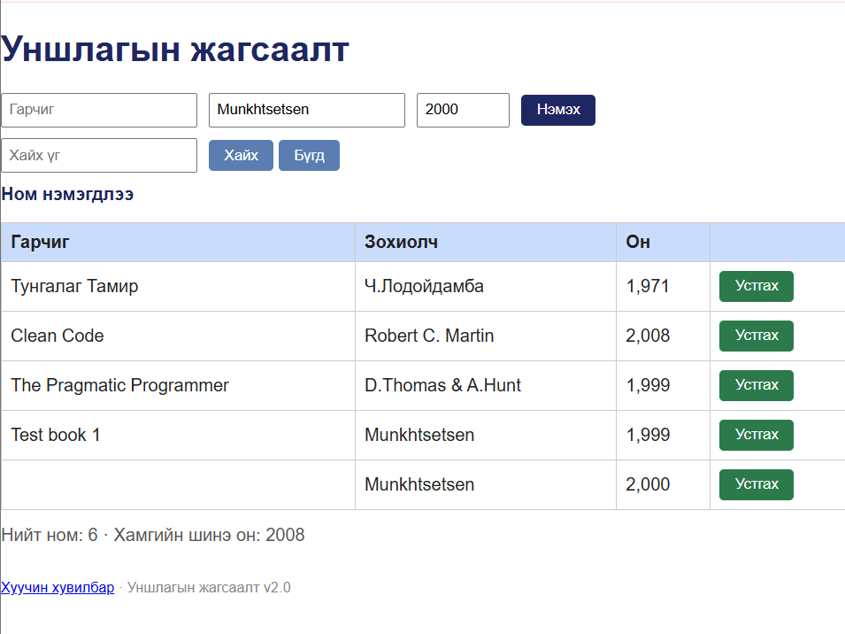

# BUG-01: Ном нэмэх үед хоосон нэртэй ном бүртгэгдэж байна

**Орчин:** Уншлагын жагсаалт v2.0, Firefox, Ubuntu Linux, 2026-10-25

**Урьдчилсан нөхцөл:** `node app.js` командыг ажиллуулж аппыг асаасан. Эхний төлөвт хүснэгтэд 3 ном харагдаж, нийт номын тоолуур 4 гэж харуулж байсан.

## Дахин гаргах алхам

1. `http://localhost:3000` хаягаар апп руу орно.
2. Ном нэмэх хэсгийн нэрийн талбарыг хоосон үлдээнэ.
3. Зохиогчийн нэр болон `1999` оныг оруулна.
4. Нэмэх товчийг дарна.
5. Гарч ирсэн мэдэгдэл болон хүснэгтийн өөрчлөлтийг шалгана.

**Хүлээгдэж байсан үр дүн:** Номын нэр заавал бөглөх талбар тул ном нэмэгдэхгүй бөгөөд хэрэглэгчид алдааны мэдэгдэл харуулна.

**Бодит үр дүн:** Апп ном нэмэгдсэн тухай мэдэгдэл харуулж, хоосон нэртэй номыг хүснэгтэд нэмсэн. Нийт номын тоолуур 5-аас 6 болж, хүснэгтийн өгөгдлийн мөрийн тоо 4-өөс 5 болсон.

**Ноцтой байдал:** Major — Номын нэргүй бүртгэл үүсэх боломжтой тул өгөгдлийн чанар, жагсаалтын бүрэн бүтэн байдалд нөлөөлнө.

**Хавсралт:** `screenshots/bug-01.png`

**Олдсон аялал:** Couch Potato — Empty input
