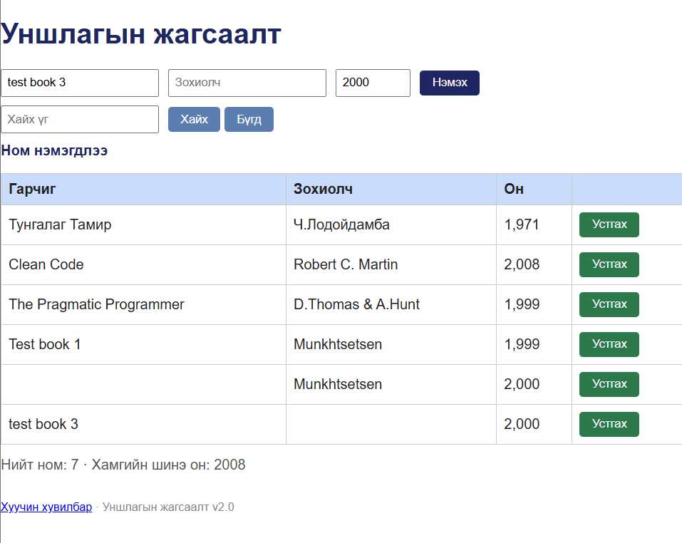

# BUG-02: Ном нэмэх үед зохиогчийн нэргүй бүртгэл үүсэж байна

**Орчин:** Уншлагын жагсаалт v2.0, Firefox, Ubuntu Linux, 2026-10-25

**Урьдчилсан нөхцөл:** `node app.js` командыг ажиллуулж аппыг асаасан. BUG-01 тестийн дараах төлөвт хүснэгтэд 5 өгөгдлийн мөр, нийт номын тоолуур 6 гэж харагдаж байсан.

## Дахин гаргах алхам

1. `http://localhost:3000` хаягаар апп руу орно.
2. Номын нэрийн талбарт тестийн нэр оруулна.
3. Зохиогчийн нэрийн талбарыг хоосон үлдээнэ.
4. `1999` гэх мэт хүчинтэй он оруулна.
5. Нэмэх товчийг дарна.
6. Гарч ирсэн мэдэгдэл болон хүснэгтийн өөрчлөлтийг шалгана.

**Хүлээгдэж байсан үр дүн:** Зохиогчийн нэр заавал бөглөх талбар тул ном нэмэгдэхгүй бөгөөд алдааны мэдэгдэл гарна.

**Бодит үр дүн:** Апп ном нэмэгдсэн тухай мэдэгдэл харуулж, зохиогчийн нэргүй номыг хүснэгтэд нэмсэн. Нийт номын тоолуур 6-аас 7 болж, хүснэгтийн өгөгдлийн мөрийн тоо 5-аас 6 болсон.

**Ноцтой байдал:** Major — Зохиогчийн мэдээлэл дутуу бүртгэгдэж, номын жагсаалтын өгөгдлийн бүрэн бүтэн байдал алдагдана.

**Хавсралт:** `screenshots/bug-02.png`

**Олдсон аялал:** Couch Potato — Empty input
