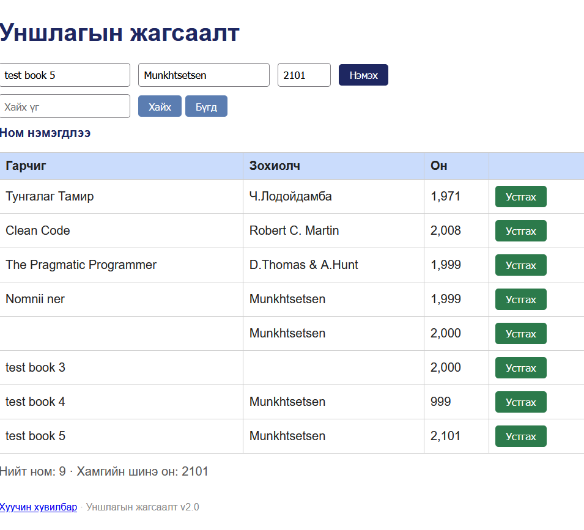

# BUG-04: 2100-аас хойших онтой номыг апп хүлээн авч байна

**Орчин:** Уншлагын жагсаалт v2.0, Firefox, Ubuntu Linux, 2026-10-25

**Урьдчилсан нөхцөл:** `node app.js` командыг ажиллуулж аппыг асаасан. Ном нэмэх хэсэг ажиллаж байна.

## Дахин гаргах алхам

1. `http://localhost:3000` хаягаар апп руу орно.
2. Номын нэр болон зохиогчийн нэрийг оруулна.
3. Оны талбарт `2101` гэж оруулна.
4. Нэмэх товчийг дарна.
5. Ном хүснэгтэд нэмэгдсэн эсэх болон нийт номын тоолуурыг шалгана.

**Хүлээгдэж байсан үр дүн:** Оны зөвшөөрөгдөх хүрээ 1000–2100 тул `2101` утгыг хүлээн авахгүй. Ном нэмэгдэхгүй бөгөөд алдааны мэдэгдэл харуулна.

**Бодит үр дүн:** Апп ном нэмэгдсэн тухай мэдэгдэл харуулж, 2101 онтой номыг хүснэгтэд нэмсэн. Нийт номын тоолуур 8-аас 9 болсон. Хүснэгтэд хамгийн сүүлийн он 2101 гэж харагдсан.

**Ноцтой байдал:** Major — Зөвшөөрөгдөх хүрээнээс гадуурх онтой өгөгдөл бүртгэгдэж, өгөгдлийн хүчинтэй байдалд нөлөөлж байна.

**Хавсралт:** `screenshots/BUG-04.png`

**Олдсон аялал:** Couch Potato — Boundary values / Invalid year
