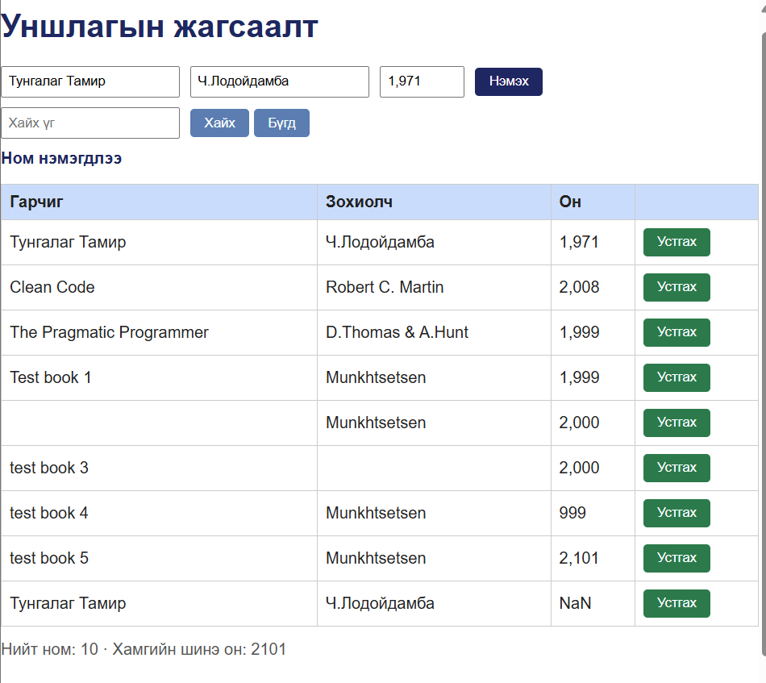

# bug-05: Ижил нэр, зохиогчтой номыг давхар бүртгэх боломжтой байна

**Орчин:** Уншлагын жагсаалт v2.0, Firefox, Ubuntu Linux, 2026-10-25

**Урьдчилсан нөхцөл:** `node app.js` командыг ажиллуулж аппыг асаасан. Давхардсан ном нэмэх тестийн өмнө хүснэгтийн өгөгдлийн мөрийн тоо 8, нийт номын тоолуур 9 байсан.

## Дахин гаргах алхам

1. `http://localhost:3000` хаягаар апп руу орно.
2. Номын нэр, зохиогчийн нэр болон оныг оруулж ном нэмнэ.
3. Ижил нэр, ижил зохиогчтой номыг дахин нэмэхээр оролдоно.
4. Нэмэх товчийг нэг удаа дарна.
5. Хүснэгт болон нийт номын тоолуурын өөрчлөлтийг шалгана.

**Хүлээгдэж байсан үр дүн:** Ижил нэр, зохиогчтой ном давхар бүртгэгдэхгүй бөгөөд хэрэглэгчид тайлбарласан мэдэгдэл харуулна.

**Бодит үр дүн:** Апп “Ном нэмэгдлээ” гэсэн мэдэгдэл харуулж, хүснэгтэд шинэ мөр нэмсэн. Хүснэгтийн өгөгдлийн мөрийн тоо 8-аас 9 болж, нийт номын тоолуур 9-өөс 10 болсон.

**Ноцтой байдал:** Major — Давхардсан бүртгэл үүсэх нь номын жагсаалтын өгөгдлийн чанарт сөргөөр нөлөөлнө.

**Хавсралт:** `screenshots/bug-05.png`

**Олдсон аялал:** Supermodel — GUI exploration
