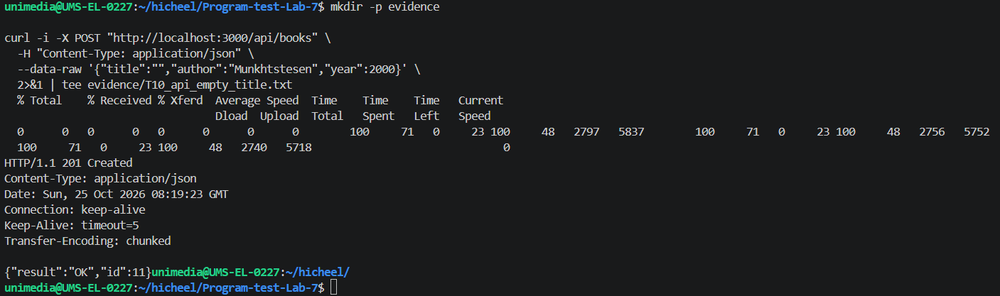

# bug-06: API хоосон нэртэй номын бүртгэлийг зөвшөөрч байна

**Орчин:** Уншлагын жагсаалт v2.0, Firefox, Ubuntu Linux, 2026-10-25

**Endpoint:** `POST http://localhost:3000/api/books`

## Дахин гаргах алхам

1. Аппыг ажиллуулж, API хүсэлт илгээх боломжтой эсэхийг шалгана.
2. Дараах request body-г `POST /api/books` endpoint руу илгээнэ.

```json
{
  "title": "",
  "author": "Munkhtstesen",
  "year": 2000
}
```

3. API-ийн HTTP статус болон response body-г шалгана.
4. Хоосон нэртэй номын бүртгэл үүссэн эсэхийг шалгана.

**Хүлээгдэж байсан үр дүн:** API нь хоосон нэртэй номын бүртгэлийг зөвшөөрөхгүй бөгөөд `400 Bad Request` эсвэл `422 Unprocessable Entity` статус буцаана. Шинэ бүртгэл үүсэх ёсгүй.

**Бодит үр дүн:** API `201 Created` статус буцааж, `{"result":"OK","id":11}` гэсэн хариу өгсөн. Хоосон нэртэй номын шинэ бүртгэл үүссэн.

**Үр дүн:** FAIL — API хоосон нэртэй номын өгөгдлийг хүлээн авч, бүртгэл үүсгэсэн.

**Ноцтой байдал:** Major — Өгөгдлийн баталгаажуулалт хангалтгүйгээс шаардлага хангахгүй бүртгэл үүсэж байна.

**Саад:** Саад гараагүй.

**Evidence:**

- `evidence/T10_api_empty_title.txt` — API хүсэлт болон хариуны нотолгоо
- `evidence/T10_api_empty_title.png` — дэлгэцийн зураг



**Олдсон аялал:** API negative testing — хоосон утгын баталгаажуулалт
